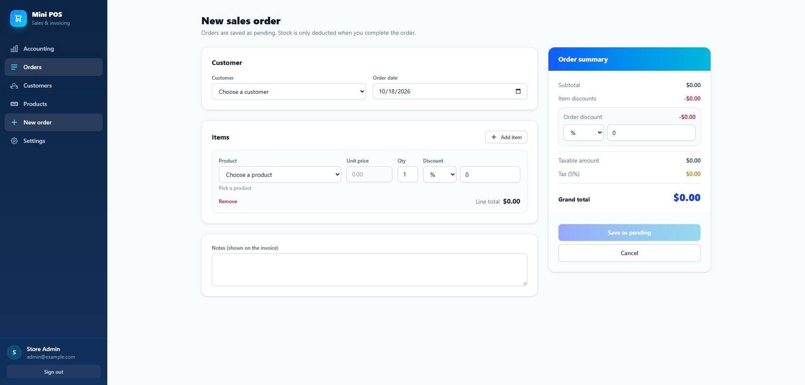
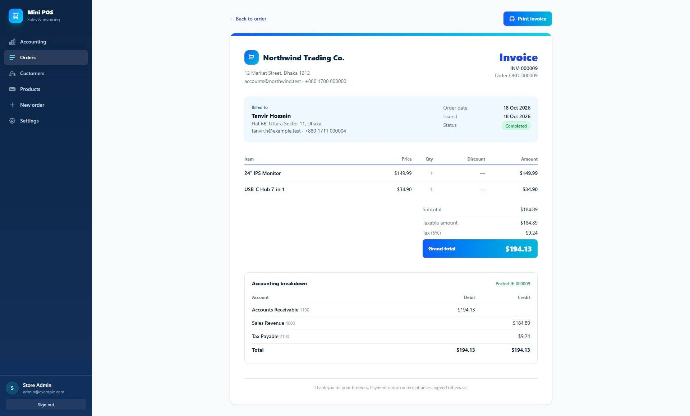
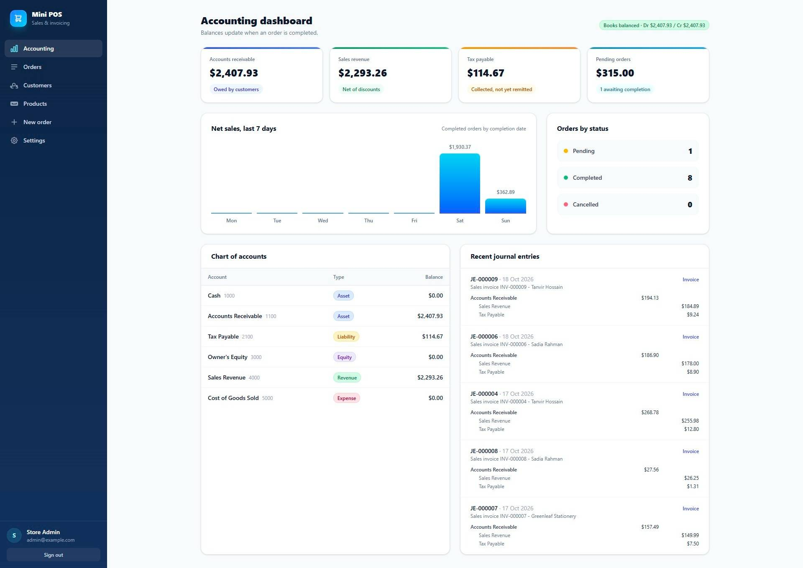

# Mini POS: Sales Orders, Invoicing & Basic Accounting

A standalone Laravel application for taking sales orders, completing them (stock + double-entry accounting), and printing invoices.

**Stack:** Laravel 13 · PHP 8.3+ · MySQL 8+ · Blade · Tailwind CSS v4 · jQuery · Vite

## Screenshots

| Order form                                      | Invoice                                   | Accounting dashboard                                                |
| ----------------------------------------------- | ----------------------------------------- | ------------------------------------------------------------------- |
|  |  |  |

---

## Setup

Requirements: PHP 8.3+, Composer, Node 20+, MySQL 8+.

```bash
git clone <your-repo-url> mini-pos && cd mini-pos

composer install
cp .env.example .env
php artisan key:generate

# create an empty database, then set DB_* in .env
mysql -u root -e "CREATE DATABASE mini_pos CHARACTER SET utf8mb4 COLLATE utf8mb4_unicode_ci"

php artisan migrate --seed

npm install
npm run build        # or `npm run dev` while developing

php artisan serve    # http://localhost:8000
```

Demo login: **admin@example.com** / **password** (you can also register a new user).

`php artisan migrate:fresh --seed` resets everything back to demo data.

### Mail (Mailpit)

Emails are sent via SMTP to [Mailpit](https://github.com/axllent/mailpit) on `localhost:1025`. View them at **http://localhost:8025**.

```
MAIL_MAILER=smtp
MAIL_HOST=127.0.0.1
MAIL_PORT=1025
```

The invoice listener is queued (`QUEUE_CONNECTION=database`). Run the worker to process it:

```bash
php artisan queue:work
```

For local dev without a worker, set `QUEUE_CONNECTION=sync` and the email fires immediately on order completion.

### What the seeders create

| Seeder            | Data                                                                                                                      |
| ----------------- | ------------------------------------------------------------------------------------------------------------------------- |
| `UserSeeder`      | 1 admin user (`admin@example.com` / `password`)                                                                           |
| `SettingSeeder`   | Default POS settings (tax rate, currency, company details, route identifier)                                              |
| `AccountSeeder`   | Chart of accounts: Cash, AR (1100), Tax Payable (2100), Owner's Equity, Sales Revenue (4000), COGS                        |
| `CustomerSeeder`  | 6 demo customers                                                                                                          |
| `ProductSeeder`   | 12 demo products                                                                                                          |
| `DemoOrderSeeder` | 3 completed + 3 pending orders via the real service layer (stock movements, journal entries, ledger balances all present) |

> Two pending orders both request 8 **Wireless Mouse** while only 8 remain. Complete one, then try the other to see the stock guard in action.

---

## How it works

### Order workflow

1. **Create** (`/orders/create`) - pick a customer, add line items. Unit prices auto-fill from the product; subtotal, discounts, tax and grand total update live (jQuery). Saved as **Pending** in a DB transaction with its line items. Stock is not touched.
2. **Edit** - pending orders can be edited. Completed or cancelled orders are blocked at the controller level (HTTP 403).
3. **Complete** - `OrderService::complete()` runs `OrderCompletionPipeline` inside a single `DB::transaction` (retried up to 3 times on deadlock):

    | #   | Stage                     | Responsibility                                              |
    | --- | ------------------------- | ----------------------------------------------------------- |
    | 1   | `LockOrder`               | `SELECT … FOR UPDATE` on the order row                      |
    | 2   | `EnsureOrderIsPending`    | Abort if not pending                                        |
    | 3   | `LockProducts`            | Lock product rows in id order (deadlock prevention)         |
    | 4   | `VerifyStockAvailability` | Throw `InsufficientStockException` if any line is short     |
    | 5   | `DeductStock`             | Decrement `stock_quantity`                                  |
    | 6   | `MarkOrderCompleted`      | Set status, `completed_at`, assign `invoice_number`         |
    | 7   | `PostSaleToLedger`        | Write journal entry + ledger lines, update account balances |

    After commit, `OrderCompleted` event fires → queued `SendInvoiceToCustomer` listener emails the invoice (3 retries, outside the transaction so email failure never rolls back the sale).

4. **Cancel** - pending orders only. Completed orders cannot be cancelled.

---

## Architecture patterns

### Pipeline (`app/Pipelines/`)

Two pipeline base classes share a common foundation:

```
BasePipeline
├── BaseFilterPipeline   - list filtering + pagination (Order, Customer, Product filters)
└── OrderCompletionPipeline - order completion stages inside DB::transaction
```

**`BasePipeline`** wraps Laravel's `Pipeline` facade. Subclasses declare their stages in `getFilters()` and optionally override `finalize()` to transform the result.

**`BaseFilterPipeline`** extends `BasePipeline` and finalises by calling `->paginate()` on the Eloquent builder that flows through the pipeline. Each filter component receives `['builder' => Builder, 'params' => array]` and returns the same shape.

**`OrderCompletionPipeline`** extends `BasePipeline` and overrides `getResults()` to wrap the entire pipeline in `DB::transaction(attempts: 3)`. Each stage implements `CompletionStage` and receives/returns a `CompletionContext` value object.

Adding a new completion step = create a class implementing `CompletionStage`, add it to `getFilters()`. No other code changes needed.

### Responsable responses (`app/Http/Responses/`)

Form controllers return `Responsable` objects instead of calling `view()` directly. This keeps controllers thin and centralises data-loading for shared forms (create + edit use the same view).

| Class                  | Loads & passes to view                            |
| ---------------------- | ------------------------------------------------- |
| `OrderFormResponse`    | All customers, active products, optional `?Order` |
| `CustomerFormResponse` | Optional `?Customer`                              |
| `ProductFormResponse`  | Optional `?Product`                               |

```php
// Controller stays to one line:
public function create(): OrderFormResponse  { return new OrderFormResponse(); }
public function edit(Order $order): OrderFormResponse { return new OrderFormResponse($order); }
```

### Data Transfer Objects (`app/DataTransferObjects/`)

Validated request data is mapped into immutable DTOs before reaching the service layer. Services never touch `Request` objects directly.

| DTO                         | Factory method                                                      |
| --------------------------- | ------------------------------------------------------------------- |
| `OrderDTO` + `OrderItemDTO` | `OrderDTO::fromRequest(StoreOrderRequest)`                          |
| `CustomerDTO`               | `CustomerDTO::fromRequest(StoreCustomerRequest)`                    |
| `ProductDTO`                | `ProductDTO::fromRequest(StoreProductRequest, bool $defaultActive)` |

### Contracts (`app/Contracts/`)

| Interface               | Bound to            | Purpose                                          |
| ----------------------- | ------------------- | ------------------------------------------------ |
| `OrderTotalsCalculator` | `OrderCalculator`   | Subtotal, discount, tax, grand total calculation |
| `SalesLedger`           | `AccountingService` | Journal entry + ledger posting                   |
| `CompletionStage`       | Each pipeline stage | Typed contract for `OrderCompletionPipeline`     |

Bindings are registered in `AppServiceProvider`. Swap an implementation (e.g. a different tax rule) without touching any caller.

### `HasUuid` trait (`app/Traits/HasUuid.php`)

Hooks into the Eloquent `creating` event to auto-assign a UUID v4 to every new model row. All models extending `BaseModel` get this for free - no manual UUID generation anywhere.

```php
// Fires on every INSERT:
static::creating(fn($model) => $model->uuid = Str::uuid()->toString());
```

### `FindByIdentifier` trait (`app/Traits/FindByIdentifier.php`)

Provides `findByIdentifier(string $value)` which resolves a model by whichever column is configured as the route identifier (`uuid`, `slug`, or `id`). Falls back to `id` if the requested column does not exist on the table (e.g. `orders` has no `slug`).

Used by `BaseModel::resolveRouteBinding()` so Laravel's route model binding automatically uses the configured column.

### `BaseModel` (`app/Models/BaseModel.php`)

All domain models extend `BaseModel` which composes:

| Trait / behaviour   | Effect                                                                                   |
| ------------------- | ---------------------------------------------------------------------------------------- |
| `HasUuid`           | UUID auto-assigned on create                                                             |
| `FindByIdentifier`  | Route binding via configured identifier column                                           |
| `HasFactory`        | Eloquent factory support                                                                 |
| `SoftDeletes`       | `deleted_at` soft-delete on every table                                                  |
| `getRouteKeyName()` | Returns `Setting::get('pos.identifier')` - falls back to `id` if the model has no `slug` |

### Settings (`app/Models/Setting.php`)

Settings are stored in a `settings` table (key/value) and loaded into a **static in-memory cache** on first access per request. This means:

- `Setting::get('pos.identifier')` hits the DB once per request regardless of how many times it is called.
- `Setting::flush()` clears the cache (called after every write in `SettingsController`).
- `AppServiceProvider::boot()` reads from `Setting::get()` to populate `config('pos.*')` for views and services that use `config()`.
- No `.env` keys are needed for POS settings - defaults are seeded by `SettingSeeder`.

---

## Data integrity (ACID)

| Property        | How it is applied                                                                                                                                                                                                                                                                                                                                         |
| --------------- | --------------------------------------------------------------------------------------------------------------------------------------------------------------------------------------------------------------------------------------------------------------------------------------------------------------------------------------------------------- |
| **Atomicity**   | Order creation (order + items) and completion (stock + status + journal + ledger) each run in one `DB::transaction`. Any exception rolls the whole unit back. `OrderCompleted` fires only after commit.                                                                                                                                                   |
| **Consistency** | Foreign keys (`restrictOnDelete`), unique `order_number`, `invoice_number`, `sku`, account `code`, journal `reference`, unique `(order_id, product_id)`. Money is `DECIMAL`, never float. Stock is `UNSIGNED` (can't go negative). Journal is checked to balance before posting. A MySQL `CHECK` ensures each ledger line is debit or credit, never both. |
| **Isolation**   | `SELECT … FOR UPDATE` on the order, its products (in id order), and accounts under InnoDB `REPEATABLE READ`. Two concurrent completions of the same order, or two orders competing for the last units, are serialised - the loser fails cleanly. Pipeline retries up to 3 times on deadlock.                                                              |
| **Durability**  | InnoDB redo log with `innodb_flush_log_at_trx_commit=1` (MySQL default).                                                                                                                                                                                                                                                                                  |

`accounts.balance` is a denormalised running total kept in sync with `ledger_entries` under the account row lock. Ledger rows are the source of truth.

**Indexes** beyond primary and foreign keys: `customers(name)`, `orders(status, completed_at)`, `orders(order_date)`, `journal_entries(entry_date)`, `ledger_entries(account_id, id)`, plus all unique keys. Order-list search uses `LIKE '%term%'` (no B-tree benefit at this scale; would move to full-text for large datasets).

---

## Calculation rules (`App\Services\OrderCalculator`)

```
line total      = qty × unit price − line discount
subtotal        = Σ(qty × unit price)
order discount  = applied to sum of line totals after line discounts
taxable amount  = subtotal − line discounts − order discount
tax             = taxable amount × tax_rate%
grand total     = taxable amount + tax
```

Discounts can be a percentage or fixed amount, per line and per order, and can never exceed the amount they apply to. Prices are **always re-read from the database on the server** - browser values are preview only.

---

## Accounting entry (`App\Services\AccountingService`)

Posted atomically inside the completion pipeline:

| Account                    | Debit       | Credit                            |
| -------------------------- | ----------- | --------------------------------- |
| Accounts Receivable (1100) | grand total |                                   |
| Sales Revenue (4000)       |             | taxable amount (net of discounts) |
| Tax Payable (2100)         |             | tax amount                        |

Each line is written to `ledger_entries` with a running `balance_after`. `accounts.balance` is updated on the account's normal side. The accounting dashboard shows a trial-balance check (total debits = total credits).

---

## Pages

| URL                              | Purpose                                                                                                        |
| -------------------------------- | -------------------------------------------------------------------------------------------------------------- |
| `/accounting`                    | Dashboard: AR, revenue, tax payable, pending value, 7-day net sales, chart of accounts, recent journal entries |
| `/accounting/accounts/{account}` | Account ledger with running balance                                                                            |
| `/orders`                        | Order list - status filter, search                                                                             |
| `/orders/create`                 | New order form                                                                                                 |
| `/orders/{order}`                | Order detail - complete / cancel / edit, accounting entry                                                      |
| `/orders/{order}/invoice`        | Printable invoice (draft watermark for non-completed orders)                                                   |
| `/customers`                     | Customer list with search, invoice count, total invoiced                                                       |
| `/customers/create`              | New customer form                                                                                              |
| `/customers/{customer}/edit`     | Edit customer                                                                                                  |
| `/products`                      | Product list - status filter, search, total units sold                                                         |
| `/products/create`               | New product form                                                                                               |
| `/products/{product}/edit`       | Edit product                                                                                                   |
| `/settings?tab=pos`              | POS settings (tax rate, currency)                                                                              |
| `/settings?tab=company`          | Company details (name, address, email, phone)                                                                  |
| `/settings?tab=identifier`       | Route identifier (uuid / slug / id)                                                                            |

---

## Project structure

```
app/
  Contracts/
    Order/               CompletionStage, OrderTotalsCalculator, SalesLedger
    Pipeline/            ComponentInterface
  DataTransferObjects/   OrderDTO + OrderItemDTO, CustomerDTO, ProductDTO
  Events/                OrderCompleted
  Exceptions/            InsufficientStockException
  Http/
    Controllers/         OrderController, AccountingController, CustomerController,
                         ProductController, SettingsController, Auth/*
    Requests/            StoreOrderRequest, UpdateOrderRequest, StoreCustomerRequest,
                         StoreProductRequest, UpdateSettingsRequest
    Responses/           OrderFormResponse, CustomerFormResponse, ProductFormResponse
  Listeners/             SendInvoiceToCustomer (queued, 3 retries)
  Mail/                  InvoiceIssued
  Models/                BaseModel, Order, OrderItem, Customer, Product,
                         Account, JournalEntry, LedgerEntry, Setting, User
  Pipelines/
    BasePipeline                         core pipeline wrapper
    BaseFilterPipeline                   paginated list filtering
    Filters/Order/                       Status + Search components → OrderFilter
    Filters/Customer/                    Search component → CustomerFilter
    Filters/Product/                     Status + Search components → ProductFilter
    Order/
      CompletionContext                  shared value object passed through stages
      OrderCompletionPipeline            DB::transaction wrapper
      Stages/                            LockOrder, EnsureOrderIsPending, LockProducts,
                                         VerifyStockAvailability, DeductStock,
                                         MarkOrderCompleted, PostSaleToLedger
  Providers/             AppServiceProvider (bindings + settings boot)
  Services/              OrderCalculator, OrderService, AccountingService
  Support/
    Enums/               OrderStatus, DiscountType, AccountType
    Helpers/             helpers.php (money() helper)
  Traits/
    HasUuid              auto-assigns UUID v4 on model creation
    FindByIdentifier     resolves models by uuid/slug/id per settings
config/
  pos.php                tax_rate, currency_symbol, company.*, accounts.*, identifier
database/
  migrations/            customers, products, orders, order_items, accounts,
                         journal_entries, ledger_entries, settings
  seeders/               UserSeeder, SettingSeeder, AccountSeeder,
                         CustomerSeeder, ProductSeeder, DemoOrderSeeder
resources/
  js/
    app.js               jQuery + SweetAlert2 bootstrap; confirm-form handler
    order-form.js        Dynamic line items, live totals, customer info panel,
                         old-items restore on validation failure
  views/
    layouts/             app.blade.php (sidebar nav), flash.blade.php, guest.blade.php
    errors/              403, 404, 500 - extend layouts.app with sidebar + Go Back button
    orders/              index, show, form (create+edit), invoice
    customers/           index, form
    products/            index, form
    accounting/          dashboard, ledger
    settings.blade.php   tabbed settings (POS / Company / Identifier)
    mail/invoice.blade.php
```

---

## Security

| Concern           | Mitigation                                                                                                                     |
| ----------------- | ------------------------------------------------------------------------------------------------------------------------------ |
| CSRF              | `@csrf` on every mutating form; Laravel's `VerifyCsrfToken` middleware                                                         |
| Mass assignment   | Explicit `$fillable` on every model; no `$guarded = []`                                                                        |
| Auth              | All routes except login/register behind `auth` middleware                                                                      |
| Authorisation     | `abort(403)` in `OrderController::update()` if order is not pending; `abort(403)` in `OrderController::edit()` same guard      |
| Product delete    | Two-level guard: blocks if product appears on a completed invoice (`sold_items_sum_quantity > 0`), then blocks if on any order |
| XSS               | Blade `{{ }}` auto-escapes all output; `{!! !!}` not used on user input                                                        |
| SQL injection     | Eloquent query builder throughout; no raw interpolated queries                                                                 |
| Route enumeration | UUID / slug route identifiers configurable; numeric `id` is opt-in                                                             |
| Secrets           | `.env` in `.gitignore`; no credentials committed                                                                               |

---

## Configuration

POS settings are stored in the `settings` DB table and managed via `/settings`. No `.env` changes needed for day-to-day configuration.

App-level `.env` keys:

```
APP_KEY=...
DB_DATABASE=mini_pos
MAIL_MAILER=smtp
MAIL_HOST=127.0.0.1
MAIL_PORT=1025          # Mailpit SMTP
QUEUE_CONNECTION=database
```

---

## Assumptions

- Discounts reduce revenue - Sales Revenue is credited with the net amount after discounts. Tax is charged on that net amount.
- Stock is validated on order creation and again under lock on completion.
- Completed and cancelled orders are immutable - cancel and re-enter to correct a mistake.
- No payment-receipt step. Receivables stay open.
- Automated tests are out of scope for this submission.

---

## Upgrade roadmap

### Near-term

| #   | Feature                | Notes                                                                                                                                      |
| --- | ---------------------- | ------------------------------------------------------------------------------------------------------------------------------------------ |
| 1   | **Automated tests**    | Feature tests for `OrderService` pipeline (happy path + stock guard + deadlock retry); unit tests for `OrderCalculator` discount/tax rules |
| 2   | **Payment receipts**   | `payments` table, `ReceivePayment` pipeline stage, AR balance tracking                                                                     |
| 3   | **Role-based access**  | `roles` / `permissions` tables (or Spatie Permission); separate cashier vs. manager vs. accountant views                                   |
| 4   | **Product categories** | `categories` table, filter products by category on order form                                                                              |
| 5   | **Stock adjustments**  | Manual stock-in / write-off with reason codes and audit trail                                                                              |

### Mid-term

| #   | Feature              | Notes                                                                                                             |
| --- | -------------------- | ----------------------------------------------------------------------------------------------------------------- |
| 6   | **Multi-currency**   | Store `currency_code` on orders; exchange-rate table; display in original + base currency                         |
| 7   | **Customer portal**  | Signed URLs for customers to view/download their own invoices without logging in                                  |
| 8   | **PDF invoices**     | Replace browser print with server-side PDF (Laravel Browsershot or DomPDF) attached to the invoice email          |
| 9   | **Full-text search** | Replace `LIKE '%term%'` on orders/customers/products with MySQL `FULLTEXT` index or Meilisearch via Laravel Scout |
| 10  | **API layer**        | REST or JSON:API endpoints for orders and products; Sanctum token auth for mobile/POS terminal clients            |

### Long-term

| #   | Feature                       | Notes                                                                                     |
| --- | ----------------------------- | ----------------------------------------------------------------------------------------- |
| 11  | **Multi-tenancy**             | Tenant-scoped DB or schema-per-tenant; each business gets isolated data                   |
| 12  | **Inventory purchase orders** | `purchase_orders` + `purchase_items`; stock-in on receipt; COGS via weighted average cost |
| 13  | **Reporting & exports**       | Date-range P&L, AR ageing, CSV/Excel export via Laravel Excel                             |
| 14  | **Audit log**                 | Immutable `audit_logs` table recording who changed what and when on every domain model    |
| 15  | **Two-factor authentication** | TOTP (Google Authenticator) via Laravel Fortify                                           |
